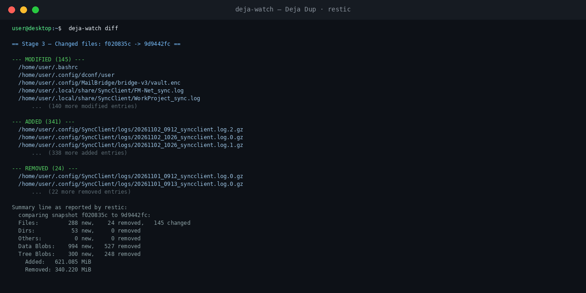

# deja-watch

An on-demand terminal companion for
[Deja Dup](https://apps.gnome.org/DejaDup/) backups.

Since the GTK4 rewrite, Deja Dup (v45+) no longer shows what older versions
did: there is no staged progress, no scanning phase, and no list of files
that changed. `deja-watch` restores that visibility in a terminal.

Deja Dup 45+ drives [restic](https://restic.net) as its backup engine.
`deja-watch` reads your existing Deja Dup settings live — repository
location, include/exclude lists, everything — and talks to the *same*
repository with plain `restic`. Nothing about your system is hardcoded,
and Deja Dup's schedule and settings are never touched.

## The classic three stages, restored

| Old Deja Dup stage      | deja-watch command | What you get |
|-------------------------|--------------------|--------------|
| 1. Scanning             | `deja-watch scan`  | Full dry run — writes nothing. Prints the include/exclude lists, files scanned, and "Would add to the repository: X MiB". |
| 2. Backing up           | `deja-watch live`  | A real verbose backup with restic's native interactive progress bar (files, bytes, rate). Asks for confirmation first. |
| 3. Changed files        | `deja-watch diff`  | Grouped **MODIFIED / ADDED / REMOVED** file lists plus restic's byte summary between the last two snapshots. Read-only. |

Stage 3 — `deja-watch diff` — in action (file names shown are anonymized):



## Commands

```
deja-watch status            repository, mount and last snapshots overview
deja-watch scan              stage 1: scan what would be backed up (dry run)
deja-watch live [extra...]   stage 2: full verbose backup (real snapshot)
deja-watch diff [n]          stage 3: files changed vs the snapshot n steps back (default 1)
deja-watch history [n]       last n snapshots (default 8)
deja-watch tap               watch the exact restic command a scheduled
                             Deja Dup run is executing, phase by phase
deja-watch env               dump resolved settings (URI, repo path, lists)
deja-watch help              full help
```

Extra arguments handed to `live` are passed straight through to restic:

```
deja-watch live --exclude '*.vdi'
```

## Requirements

- Deja Dup 50 (the restic-engine rewrite) — tested with 50.0
- `restic` — tested with 0.18
- A working Deja Dup backup configuration (run a backup once first so the
  repository exists)
- `bash`, `python3`, `gsettings` (any modern GNOME-based desktop has these)
- For remote backends (IP servers, cloud storage), the gvfs mount —
  `deja-watch` triggers it automatically when needed

## Install

```
mkdir -p ~/.local/bin
install -m 755 deja-watch ~/.local/bin/deja-watch
```

Make sure `~/.local/bin` is on your PATH (most distros include it by
default for this path), then run `deja-watch help`.

## How it works

- **Repository path, URI and mount** are derived live from Deja Dup's
  gsettings (backend URI + folder spec), so the tool keeps working if you
  move your NAS, change IP, or switch backend types.
- **Include list** comes from Deja Dup's include-list.
- **Exclude list** is read back from the latest snapshot itself, i.e. it is
  exactly the effective set Deja Dup uses — including its built-in excludes
  that never appear in the GUI (caches, `/proc`, `/sys`, `/tmp`, …).
- **Password handling** mirrors your repository's: passwordless (Deja Dup's
  current default) or via `RESTIC_PASSWORD` if you ever set a passphrase.
- **Manual snapshots** created by `deja-watch live` are tagged
  `deja-dup,deja-watch`, live in the same repository, and age out under the
  same retention policy as Deja Dup's own. Any snapshot Deja Dup has ever
  made remains fully usable.

## Notes and limitations

- All snapshot times shown are UTC, as restic stores them.
- `deja-watch live` creates a real snapshot; it will prompt
  before doing so.
- `deja-watch diff` only lists paths, as restic reports them.
- The `tap` command watches the log Deja Dup writes for its own runs
  (`~/.cache/deja-dup/restic.log`); it shows commands, not live progress,
  and works while a scheduled backup is running.
- Designed for the restic-based Deja Dup (v45 and later, the bundled-restic
  era). It does not read duplicity-format archives from the pre-restic era.

## Tested with

- Deja Dup 50.0 (package 50.0-3), Kubuntu 26.04
- restic 0.18.1
- NAS backend `ftp://` via gvfs FUSE

`scan`, `diff`, `status`, `history`, `tap` and `env` verified against a live
210 GB-class repository; `live` shares the same argument path as `scan`.

## Status

- Version 0.1.0, first working release.
- Bug reports and patches welcome — please include `deja-watch env`
  output (redact anything you prefer) and the restic version.

## License

GPL-3.0-or-later — see [LICENSE](LICENSE).
`deja-watch` is not part of Deja Dup or restic; it is an independent,
unaffiliated companion tool.
